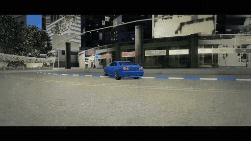
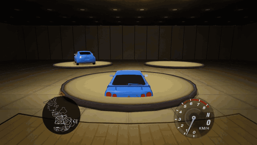
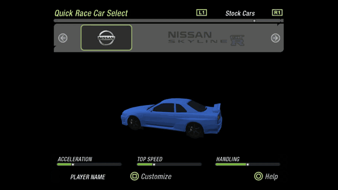
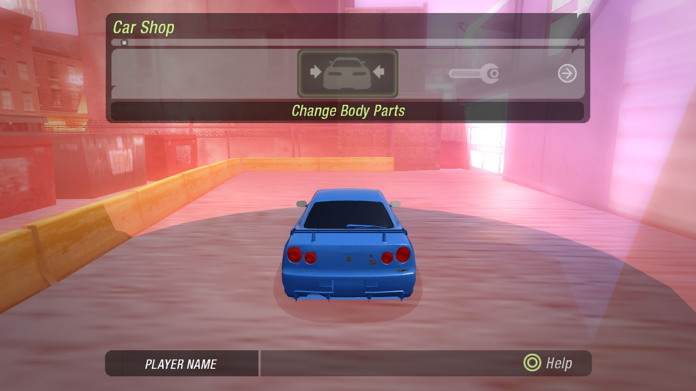
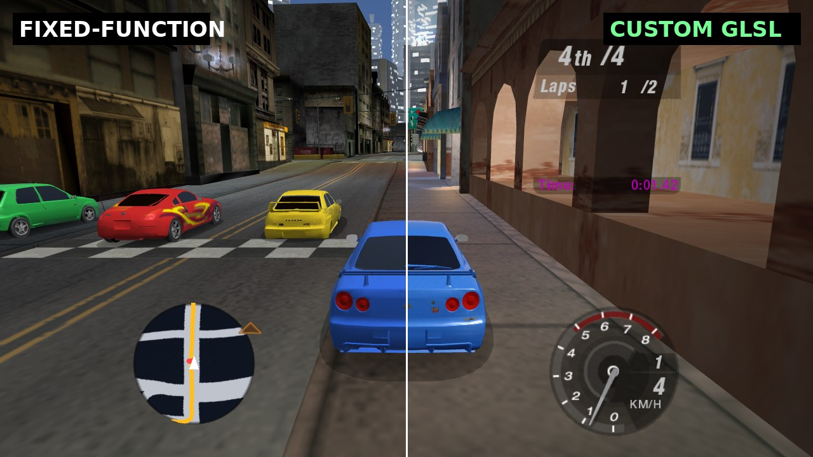
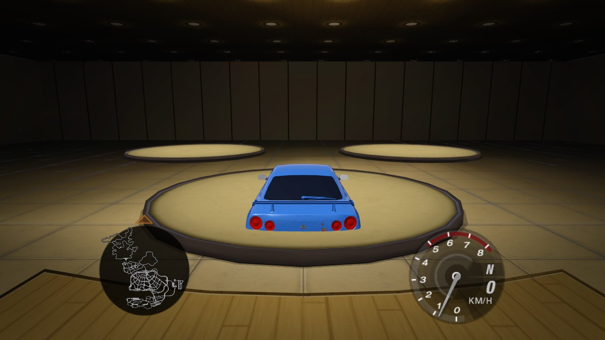
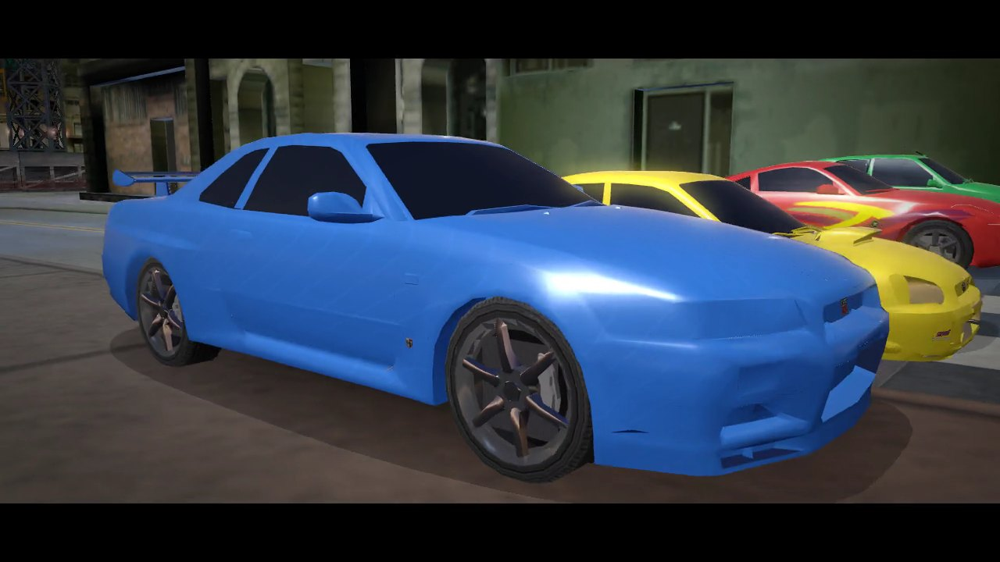

<div align="center">

# 🏁 nfsu2_decomp

### *Need for Speed: Underground 2* — rebuilt from the PS2 binary as **native Linux code**

**No emulator. No Wine. No Proton. No PS2 CPU, VU or GS emulation.**
Every frame you see is produced by readable C++ and OpenGL running directly on your machine.


*Live capture of the native build: the player's Skyline, three AI rivals, the generated minimap and the
original tachometer — all running from decompiled game logic and the disc's own data files.*

</div>

---

## What is this?

This project is a **functional decompilation** of *Need for Speed: Underground 2* (PlayStation 2, PAL v2.00,
`SLES_527.25`). Instead of emulating the console, the game's logic is reverse-engineered from the MIPS R5900
executable and rewritten as ordinary C++:

| PS2 hardware | Linux replacement |
|---|---|
| EE CPU + VU0/VU1 microcode | Native C++ (VU strip data decoded into plain triangles) |
| GS rasteriser | OpenGL 2.x-style pipeline with custom GLSL shaders |
| SPU2 / IOP audio | SDL2 audio mixer fed from the game's own sound banks |
| DVD + `ZDIR.BIN` archive | A native reader for the disc's `ZDIR.BIN` + `ZZDATA*.BIN` |
| Memory card | A save layer writing profile files (versioned, currently v21) |

It is a **bring-your-own-disc** project. The repository contains **no game code and no game assets** — you
supply your own legally obtained copy of the game and the program reads it at run time.

## See it running

<table>
<tr>
<td width="50%"><br/><sub><b>Cinematic pre-race camera</b> — dolly, orbit and crane into the chase cam, with letterbox bars.</sub></td>
<td width="50%"><br/><sub><b>Career garage</b> — the real <code>CRIB01</code> room with display discs and your other cars.</sub></td>
</tr>
<tr>
<td width="50%"><br/><sub><b>Quick Race car select</b> — real car database, live stat bars from the decompiled rating formulas.</sub></td>
<td width="50%"><br/><sub><b>Free-roam hot spots</b> — shop locations decoded from the region data; roll in and the shop opens.</sub></td>
</tr>
</table>

## Custom shaders

The PS2 had no programmable pixel pipeline, so the original look is baked into textures and vertex colours.
This port keeps the original assets but renders them through a set of **custom GLSL programs** (GLSL 1.20, so
they also work on older drivers; automatic fallback to fixed-function with `NFSU2_NO_SHADERS=1`).

<div align="center">
<br/>
<sub>Left: fixed-function path. Right: custom shader path. (Two different instants of the same scene.)</sub>
</div>

| Shader | What it does |
|---|---|
| **World grade + fog** | Colour grading and distance fog on the whole city (`World/Shaders.h`) |
| **Car clear coat** | Per-pixel lit paint with Fresnel and a procedural sky reflection; vertex normals and gloss are rebuilt from the model |
| **Wheel materials** | Separate alloy-rim, rubber-tyre and brake-disc shading, hub-relative normals, spoke blur at speed |
| **Interior-mapped windows** | Tall office facades fake whole rooms behind the glass with a ray/box test — zero extra geometry |
| **Wet-road look** | Puddle mask from two noise octaves, sheen on road-like surfaces, streaked lamp reflections |
| **Post-process** | Bright-pass → two-pass blur bloom, vignette and exposure, composited before the HUD |
| **Hot-spot beacons** | Additive light columns marking shops, car lots and the crib |

<div align="center">


</div>

## How much of the game is done?

Honest numbers first, because "percent complete" means different things for a decompilation:

| Measure | Result |
|---|---|
| Functions in the PS2 executable (Ghidra) | **16,897** |
| Functions individually traced to an address in our source/notes | **≈ 787 (4.7 %)** — about **7 %** of the code by size |
| UI screens (`.fng` packages) ported | **≈ 60 of 150** — and roughly **58 % of the 104 that are not online / debug / demo** |
| Findings, decodes and design notes logged | **268 entries** in [`ISSUES.md`](ISSUES.md) |
| C++ written | ~31,000 lines (plus the vendored CC0 engine core) |

> **Why the function percentage is low:** the executable holds a huge amount of code this project deliberately
> does **not** port one-for-one — online lobbies (~35 screens), the Sony/IOP/network SDKs, PS2 DMA/VU upload
> plumbing, and EA's engine layer that is shared with the CC0 *Most Wanted* decompilation. Where the original
> hardware code isn't needed on Linux, we replace it instead of translating it. The number that matters for
> *playability* is the feature table below.

### Feature status (estimate)

| Area | Status | Notes |
|---|---|---|
| Boot, EA logos, movies | ✅ working | Boot order mirrors `0x2dbd88` |
| Front end / menus | 🟢 ~60 % of the screens | Main menu, Options (persisted), Quick Race flow, profiles, virtual keyboard |
| Quick Race | ✅ playable | Real car DB, tracks, 3-2-1 start, laps, finish, results, best times |
| Free roam / city | ✅ working | Whole city streams in, collision mesh, ambient traffic, minimap, full map |
| Driving physics | 🟢 solid | UG2 vehicle model from the car records, drivetrain, tuning, manual gearbox |
| AI opponents | 🟢 working | Route followers with skill scaling and vinyls |
| Career mode | 🟡 mostly | Events, areas, sponsors, SMS inbox, car lot, crib, progression rules decoded |
| Car customisation | 🟡 mostly | Parts, performance packages, tuning sliders, dyno, vinyls, decals, paint, rims, spinners, neon |
| Garage / shops (3D) | 🟡 partial | Garage room renders; shop hot spots placed; per-shop filtering not done |
| Graphics | 🟢 beyond original | Custom shaders, MSAA, anisotropic filtering, widescreen Hor+ |
| Audio | 🟡 partial | Engine, skid, turbo and UI sounds; music streams; full mix not final |
| Online / network | ⛔ out of scope | Needs EA servers that no longer exist |
| Stock paint colours, magazine/showcase screens, NOS graph | 🔴 open | Documented in `ISSUES.md` |

If you want **one number** for "can I play the game": roughly **half of the single-player game is reachable
and playable natively today** (menus → Quick Race → free roam → career flow → customisation), with the long
tail being polish screens, shops' per-category logic and audio mixing.

## Quick start

Built as **native 32-bit x86** (the original data and EA's engine code assume 4-byte pointers). You need
`g++-multilib`, CMake, Ninja and `libsdl2-dev:i386`.

```sh
cmake -S . -B build -G Ninja -DCMAKE_TOOLCHAIN_FILE=cmake/linux-i386.cmake
cmake --build build
./build/bware_test                                   # engine core self-test
NFSU2_DATA=/path/to/your/disc ./build/nfsu2 --test    # disc file-system self-test
NFSU2_DATA=/path/to/your/disc ./build/nfsu2           # play
```

`/path/to/your/disc` must contain `NFSUNDER/ZDIR.BIN` and `ZZDATA*.BIN` from **your own** PAL disc image.

| Key | Action |
|---|---|
| Arrows / WASD | Steer and menu navigation |
| Enter / Space | Accept |
| **Esc** | Back in menus, **pause** while driving |
| X | Pad square (Customize / Repaint) |
| Q / E | L1 / R1 |
| F10 | Quit |

The window is 16:9 by default and resizable. The 3D world widens with the window (no stretching), while the
UI keeps its original 4:3 layout, pillar-boxed.

<details>
<summary><b>Useful developer environment variables</b></summary>

| Variable | Effect |
|---|---|
| `NFSU2_WORLD=L4RA` | Jump straight into a region |
| `NFSU2_RACE=4012` | Start a specific race |
| `NFSU2_RACETYPE=9` | Free roam |
| `NFSU2_DRIVE="3500-9000:up,..."` | Hold buttons for a time window (hand-driven tests) |
| `NFSU2_SPAWN=x,y,yaw` | Teleport the player (dev aid) |
| `NFSU2_HOTSPOTS=1` | Show shop beacons outside career free roam |
| `NFSU2_SCENE=CRIB01` | Load a shop/garage scene |
| `NFSU2_NO_SHADERS=1` | Fixed-function fallback |
| `NFSU2_MSAA=0/2/4/8` | Multisampling |
| `NFSU2_SCREENSHOT=f.bmp` | Save the whole window and quit |
| `NFSU2_MEMCARD=dir` | Use a scratch save directory |

</details>

## How it was done (the short version)

1. **Extract the disc.** `tools/zdir_names.py` and `tools/zz_extract.py` solved the `ZDIR.BIN` index
   (24-byte records keyed by EA's `bStringHash`) and pull files out of `ZZDATA0-3.BIN`.
2. **Analyse the executable.** Ghidra with the *Emotion Engine* extension decompiles the R5900 code; a
   pseudocode dump of all 16,897 functions is kept **locally** (never committed) and used as the reference.
3. **Decode the data.** EA `bChunk` containers, JDLZ compression, TPK textures, solid meshes whose triangle
   strips live in **VU1 packets** (including the odd-vertex UV swap and R-register ADC strip topology), the
   collision mesh, road/traffic graphs, the car database, part database, GLOBALB career tables, FNG UI
   packages and the audio banks.
4. **Rewrite, don't emulate.** Each decoded behaviour becomes normal C++ with a `// 0xADDRESS` comment to
   its original. Bugs and findings are recorded in [`ISSUES.md`](ISSUES.md) (268 entries so far — read it,
   it is the real project diary).
5. **Reuse where legal and sensible.** The engine core shared with the CC0 *Most Wanted* decompilation
   ([`dbalatoni13/nfsmw`](https://github.com/dbalatoni13/nfsmw)) is vendored in `third_party/nfsmw`.

## Repository layout

| Path | What |
|---|---|
| `src/game/bWare/` | EA Black Box engine core |
| `src/game/indep/` | Platform-independent game code: `Career/`, `Frontend/`, `Physics/`, `Sound/`, `World/`, `Texture/`, `FEng/` |
| `src/platform/linux/` | Linux replacements for PS2 hardware and SDK calls |
| `tools/` | Archive, chunk, VU-strip, audio and hot-spot analysis scripts |
| `docs/` | Function map, UI screen registry, physics notes, media |
| `third_party/nfsmw/` | Vendored CC0 engine code, local changes in `PATCHES.md` |
| `ISSUES.md` | Numbered log of every decode, fix and open question |

## 🚀 The future: smart optimisation and smart memory

The PS2 version was designed around **32 MB of RAM, 4 MB of VRAM, fixed DMA budgets and a DVD seek time**.
Every one of those limits shaped the original code — and none of them exist on a modern Linux box. Now that
the game runs as plain native code, those assumptions can be replaced instead of preserved. This is the
roadmap (all **planned**, none of it is done yet):

**Smart memory management**
- 🧠 **Budgeted residency manager** — replace the PS2's fixed streaming slots with a single arena-based
  manager that tracks every texture, solid and sound with a cost, priority and last-use time, and evicts by
  value instead of by slot.
- 🗜️ **Asynchronous decompression** — JDLZ/Huffman decode on worker threads feeding a lock-free queue, so the
  render thread never waits on a chunk (today it decodes the region synchronously at load).
- 📦 **64-bit clean data layer** — the 32-bit build exists only because EA's chunk layouts embed pointers.
  A load-time relocation pass would let the engine run as a normal 64-bit process.
- 🔍 **Built-in memory telemetry** — an in-game overlay (and `--mem-report`) showing live residency, peak
  usage, fragmentation and per-subsystem budgets, so every change can be measured.

**Smart optimisation**
- 🎯 **GPU-driven world rendering** — the city is ~61,000 placed instances and ~4 million triangles; move
  culling and instancing onto the GPU instead of rebuilding client-side arrays per cell.
- 🧩 **Texture streaming and atlasing** — mip-level residency from screen-space size, one bindless/atlas path
  instead of a bind per run.
- 📈 **Adaptive quality** — a frame-time controller that raises/lowers MSAA, draw distance, bloom and shadow
  quality to hold a target frame rate.
- 🧵 **Job-system simulation** — traffic, AI and collision queries on a thread pool with deterministic
  results, so physics stays identical to the original model.
- 🧪 **Profile-guided regression tests** — golden-frame and golden-lap tests so optimisations can never
  silently change gameplay.

## Credits and legal

- Original code in this repository is under the [MIT License](LICENSE); `third_party/nfsmw` keeps its own (CC0).
- Built by reverse-engineering a personally owned copy of the game for **interoperability, preservation and
  education**. All game code and art remain the property of Electronic Arts.
- **This repository contains no EA code, executables, textures, models, music or other assets.** The
  screenshots and GIFs under `docs/media` are captures of the running program, included to document the
  project; if a rights holder objects, they will be removed.
- Not affiliated with or endorsed by Electronic Arts or Black Box.
- Thanks to [`dbalatoni13/nfsmw`](https://github.com/dbalatoni13/nfsmw) (CC0 Most Wanted decompilation),
  [`cobanov/nfsu2-decomp`](https://github.com/cobanov/nfsu2-decomp) (GC/PC day-zero work), the Ghidra project
  and the `ghidra-emotionengine-reloaded` extension.

---

<div align="center"><sub>Made on Kali Linux. No emulators were harmed in the making of this port.</sub></div>
