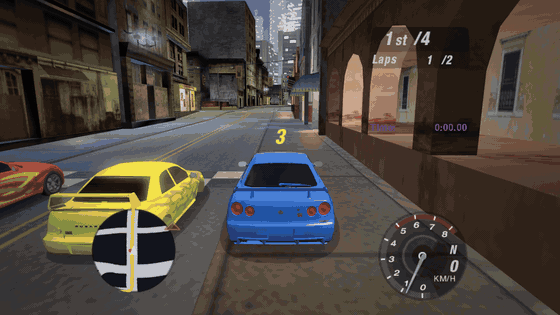
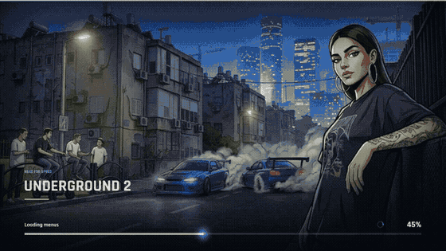
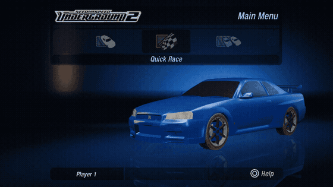
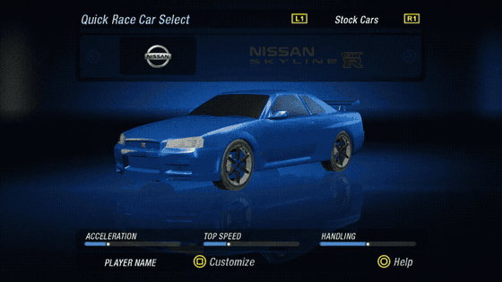
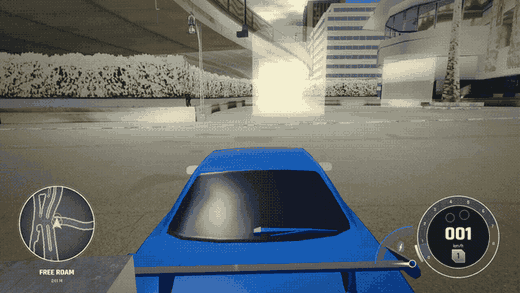
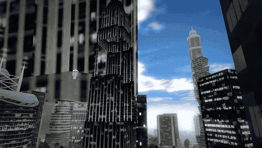
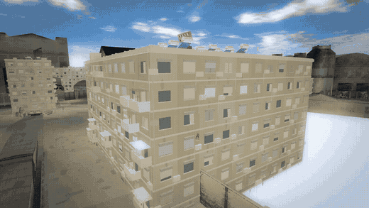
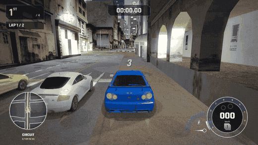
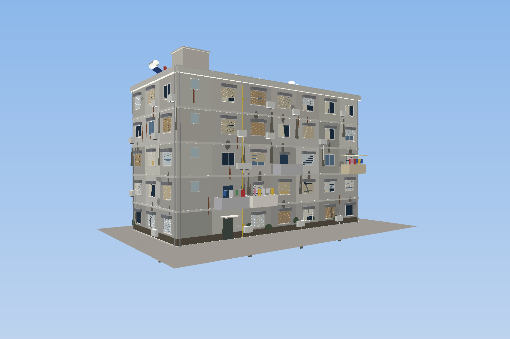
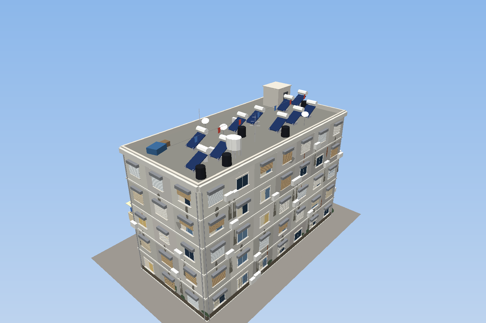

<div align="center">

# 🏁 nfsu2_decomp

### *Need for Speed: Underground 2* — rebuilt from the PS2 binary as **native Linux code**

**No emulator. No Wine. No Proton. No PS2 CPU, VU or GS emulation.**
Every frame you see is produced by readable C++ and OpenGL running directly on your machine.




*Live capture of the native build: the player's Skyline against AI rivals, in daylight with the procedural sky,
the modern HUD with its glass minimap and speed dial, and the original race logic underneath.*

</div>

---

## What is this?

This project is a **functional decompilation** of *Need for Speed: Underground 2* (PlayStation 2, PAL v2.00,
`SLES_527.25`). Instead of emulating the console, the game's logic is reverse-engineered from the MIPS R5900
executable and rewritten as ordinary C++:

| PS2 hardware | Linux replacement |
|---|---|
| EE CPU + VU0/VU1 microcode | Native C++ (VU strip data decoded into plain triangles) |
| GS rasteriser | OpenGL pipeline with custom GLSL shaders |
| SPU2 / IOP audio | SDL2 audio mixer fed from the game's own sound banks |
| DVD + `ZDIR.BIN` archive | A native reader for the disc's `ZDIR.BIN` + `ZZDATA*.BIN` |
| Memory card | A save layer writing profile files (versioned, currently v21) |

It is a **bring-your-own-disc** project. The repository contains **no game code and no game assets** — you
supply your own legally obtained copy of the game and the program reads it at run time.

On top of the faithful port sits a deliberately **modern presentation layer** — shader sky, god rays, a 3D
showroom for the menus, a new loading screen, a rebuilt HUD and a re-skinned, Israeli-themed city — all
switchable off with environment variables (see the table at the bottom) if you want the original look.

## See it running

<table>
<tr>
<td width="50%"><br/><sub><b>Loading screen</b> — full-window artwork with a slow push-in, a glass progress bar that only moves forward across every load phase (menus, race interface, streaming and building the city), stage names and rotating hints.</sub></td>
<td width="50%"><br/><sub><b>Main-menu showroom</b> — the real 3D car on a dark studio floor with a mirrored reflection, softbox light panels and a gentle camera sway, behind the original menu.</sub></td>
</tr>
<tr>
<td width="50%"><br/><sub><b>Car select</b> — the car under studio strip lights turns slowly; changing car, paint or parts updates it live, through the same car shader the race uses.</sub></td>
<td width="50%"><br/><sub><b>Free-roam events</b> — a light column marks every open career event; drive into it and the event is offered with its real name, type, distance and purse.</sub></td>
</tr>
<tr>
<td width="50%"><br/><sub><b>Sky, god rays and lens reflections</b> — a per-pixel procedural sky with drifting cumulus and cirrus, shafts of sun cut out by the buildings, and lens ghosts, a halo and a streak while the sun is in view.</sub></td>
<td width="50%"><br/><sub><b>Old apartment blocks</b> — generated "shikun" buildings with slatted plastic shutters, wall air-conditioners, balconies and a roof of solar water heaters, in Jerusalem stone.</sub></td>
</tr>
<tr>
<td colspan="2" align="center"><br/><sub><b>Night racing</b> (<code>NFSU2_NIGHT=1</code>) — emissive headlights and tail lights, glass covers, light pools on the road, dusk sky with stars.</sub></td>
</tr>
</table>

## A modern presentation layer

| Piece | What it does | Log |
|---|---|---|
| **Loading screen** | `ModernUI::DrawLoading`: your artwork cover-fitted with a Ken-Burns drift, grading, hints, a single monotonic progress bar fed by every loader (`FENativeInterface::SetLoadingHook`, `TrackWorld::SetProgress`) | #301 |
| **Menu showroom** | `TrackWorld::RenderStage`: dark studio backdrop shader, the car drawn by the race's car shader in a *studio* environment (overhead strip box, tall coloured panels), mirrored reflection pass, glossy fading floor, light pool, bloom | #304 |
| **Modern HUD** | Glass minimap rendered from the live road mesh, speed dial with nitrous gauge, drift counter, wind streaks and a radial speed blur (references: NFS Unbound) | #276, #295–#298 |
| **Hybrid UI theme** | The original FEng menus keep their layout but are recoloured to the HUD palette | #290 |
| **Pause dialog** | Glass panel on Esc: resume, restart, options, main menu, quit | #281 |
| **Built-in profiler** | `F3`: frame time, CPU sections, GPU timer queries, a bound-ness verdict; draw-call batching and a single vertex arena took the city from 27 to a locked 60 fps | #282, #283 |

## Atmosphere

<div align="center">

<br/>
<sub>The exported <code>shikun</code> asset (5 floors, ~26,000 triangles, rendered here by the project's own tiny software rasteriser — flat vertex colours, no lighting).</sub>
</div>

- **Procedural shader sky (#302)** — a per-pixel view ray through a scattering-style gradient, a sun with disc, glare and warm low-sun band, perspective-projected cumulus with self-shadowed bases and silver rims, a high cirrus veil, and at night stars and a moon.
- **God rays and lens reflections (#305)** — the post pass keeps the frame's depth (far = sky) and marches 48 jittered samples from every pixel towards the sun, so shafts only appear through real gaps; five ghosts, a halo ring and an anamorphic streak appear while the sun disc is visible; the sun is also mirrored in the interior-mapped window glass. Costs about 1.7 ms of GPU time.
- **Weathered ground (#299, #300)** — a worn asphalt with repaired patches, fine cracks, stains and sheen; Israeli interlocking paving ("Eckerstein") with per-block tones, pale worn edges, sandy joints, dry leaves and litter; painted kerbs that are sun-bleached, chipped and grimy at the foot.
- **An Israeli city (#272–#280, #306)** — four districts blended by the world shader (Tel Aviv Bauhaus, Jerusalem stone, Haifa terraces, Be'er Sheva brutalist concrete) with CC0 photographic materials, Hebrew signage, ~2 million triangles of street life (palms and pines, bus stops, scooters, cafés, dumpsters with cats, EV chargers, utility poles and cables, balconies, roller shutters, awnings) and generated buildings: Bauhaus "White City" blocks in Tel Aviv, old **shikun** apartment blocks elsewhere.
- **Wet roads, interior-mapped offices, bloom, MSAA 4×, anisotropic filtering, widescreen Hor+** from the earlier shader work.

### The apartment-block asset

`./build/nfsu2 --export-shikun <base> [floors width depth seed]` writes the building as `<base>.obj` (vertex colours after `x y z`) and `<base>.ply`. Two ready-made blocks are in [`assets/israel/shikun/`](assets/israel/shikun). It has weathered plaster panels, sliding aluminium windows with sills and lintels, **plastic roller shutters in every state** (each slat is geometry in the export), wall-mounted air-conditioner condensers with drain pipes and damp streaks, balconies with laundry, a glass-block stair tower, a yellow gas riser, patches of peeled plaster and rust, and a flat roof crowded with **solar water heaters (white tank on a flat black panel)**, black tanks, dishes and aerials. Honest limits: flat vertex colours rather than UV textures, no open ground floor, no interior.

## Custom shaders

The PS2 had no programmable pixel pipeline, so the original look is baked into textures and vertex colours.
This port keeps the original assets but renders them through **custom GLSL programs** (GLSL 1.20, so they work on older drivers; automatic fallback to fixed-function with `NFSU2_NO_SHADERS=1`).

| Shader | What it does |
|---|---|
| **World grade + fog + district theme** | Colour grading, distance fog, four-district facade re-skinning and photographic materials (`World/Shaders.h`) |
| **Road and pavement** | Worn asphalt, paver pattern, painted kerbs, wet-road puddles and sheen |
| **Sky** | Procedural atmosphere, sun, two cloud layers, night stars and moon |
| **Car clear coat** | Per-pixel lit paint with Fresnel and a procedural environment (night city, or the studio in the menus) |
| **Wheel materials** | Alloy rim, rubber tyre and brake-disc shading, hub-relative normals, spoke blur at speed |
| **Interior-mapped windows** | Tall office facades fake whole rooms behind the glass with a ray/box test, plus a sun glint — zero extra geometry |
| **Post-process** | Bloom, filmic curve, vignette, radial speed blur, **god rays** and **lens reflections** from the frame's depth |
| **Studio stage** | Backdrop with accent glow, light slabs and horizon seam for the menu showroom |
| **Lamps and glass** | Emissive lenses that react to the brake pedal, translucent clear covers, soft glows, night light pools |
| **Hot-spot and event beacons** | Additive light columns marking shops, car lots, the crib and open career events |

## Free-roam career layer

The region data hides a whole trigger layer (#303): named locators in `PATHSFREEROAM.BIN`. Every career event record names the locator it starts at, so the 221 events now have real places on the map — drive into the marker and the event is offered; Accept starts the race. The same layer holds the car-show spots, the unique-part events and the tutorial-tip spots (decoded, not yet ported).

## Camera

The original game's cameras were rebuilt on a small spring-based rig (`World/CameraRig.h`) so every move is frame-rate independent and nothing ever pops:

| Camera | What it does |
|---|---|
| **Chase** | Spring heading, distance and height; leans into the car's *real* direction of travel in a slide; lens widens 70° → ~81° with speed (+7° with nitrous); noses down under braking; subtle shake at speed |
| **Pre-race cinematic** | Three constant-speed shots, then an orbit round the car (never through it) into the chase view, with letterbox bars |
| **Garage** | The open shop screen maps to a pose: bumpers, skirts, spoiler, hood, roof, lights, exhaust, rims, paint, neon |
| **Showroom** | Menu orbit and sway around the staged car |

## How much of the game is done?

Honest numbers first, because "percent complete" means different things for a decompilation:

| Measure | Result |
|---|---|
| Functions in the PS2 executable (Ghidra) | **16,897** |
| Functions individually traced to an address in our source/notes | **≈ 810 (4.8 %)** — about **8 %** of the code by size |
| UI screens (`.fng` packages) ported | **≈ 65 of 150** — about **62 % of the 104 that are not online / debug / demo** |
| Findings, decodes and design notes logged | **307 entries** in [`ISSUES.md`](ISSUES.md) |
| Commits | **350+** |
| C++ written | **≈ 38,600 lines in 114 files** (plus ≈ 287,000 lines of vendored CC0 engine core) |
| Frame rate | **60 fps** at 1280×720 with MSAA 4× on an integrated GPU (Intel Iris Xe); the new god-ray pass costs ≈ 1.7 ms |
| Triangles in view in the city | ≈ 1.1 million per frame, ≈ 560 draw calls |

> **Why the function percentage is low:** the executable holds a huge amount of code this project deliberately
> does **not** port one-for-one — online lobbies (~35 screens), the Sony/IOP/network SDKs, PS2 DMA/VU upload
> plumbing, and EA's engine layer that is shared with the CC0 *Most Wanted* decompilation. Where the original
> hardware code isn't needed on Linux, we replace it instead of translating it. The number that matters for
> *playability* is the feature table below.

### Feature status (estimate)

| Area | Status | Notes |
|---|---|---|
| Boot, EA logos, movies | ✅ working | Boot order mirrors `0x2dbd88`; the loading screens are replaced by the new one |
| Front end / menus | 🟢 ~62 % of the screens | Main menu, Options, Quick Race flow, profiles, keyboard, 3D showroom background |
| Quick Race | ✅ playable | Real car DB, tracks, 3-2-1 start, laps, finish, results, best times |
| Free roam / city | ✅ working | Whole city streams in, collision mesh, traffic, minimap, full map, shop and event locators |
| Driving physics | 🟢 solid | UG2 vehicle model from the car records, drivetrain, tuning, drift layer, regression benchmark |
| AI opponents | 🟢 working | Route followers with skill scaling |
| Career mode | 🟡 mostly | Events, areas, sponsors, SMS inbox, car lot, crib, progression rules, events started from the street |
| Car customisation | 🟡 mostly | Parts, performance packages, tuning sliders, dyno, vinyls, decals, paint, rims, spinners, neon |
| Garage / shops (3D) | 🟡 partial | Garage room renders with a part-following camera; per-shop filtering not done |
| Graphics | 🟢 beyond original | Custom shaders, shader sky, god rays, MSAA, widescreen Hor+, working car lights and glass |
| Audio | 🟡 partial | Engine, skid, turbo, wind and UI sounds; music streams; full mix not final |
| Online / network | ⛔ out of scope | Needs EA servers that no longer exist |
| Car-show / magazine screens, Uniques shop, tutorial pop-ups, reverse lamps | 🔴 open | Documented in `ISSUES.md` (#247, #303) |

If you want **one number** for "can I play the game": roughly **half of the single-player game is reachable
and playable natively today** (menus → Quick Race → free roam → career flow → customisation), with the long
tail being polish screens, shops' per-category logic and audio mixing.

## Quick start

Built as **native 32-bit x86** (the original data and EA's engine code assume 4-byte pointers). You need
`g++-multilib`, CMake, Ninja and `libsdl2-dev:i386`.

```sh
cmake -S . -B build -G Ninja -DCMAKE_TOOLCHAIN_FILE=cmake/linux-i386.cmake
cmake --build build
./build/bware_test                                   # engine core self-test
NFSU2_DATA=/path/to/your/disc ./build/nfsu2 --test    # disc file-system self-test
NFSU2_DATA=/path/to/your/disc ./build/nfsu2           # play
```

`/path/to/your/disc` must contain `NFSUNDER/ZDIR.BIN` and `ZZDATA*.BIN` from **your own** PAL disc image.

| Key | Action |
|---|---|
| Arrows / WASD | Steer and menu navigation |
| Enter / Space | Accept |
| **Esc** | Back in menus, **pause** while driving |
| X / Left Shift | Handbrake while driving (starts a drift); pad square in menus |
| Q / E | L1 / R1 |
| F3 | Performance overlay |
| F10 | Quit |

The window is 16:9 by default and resizable. The 3D world widens with the window (no stretching), while the
UI keeps its original 4:3 layout, pillar-boxed.

<details>
<summary><b>Useful developer environment variables</b></summary>

| Variable | Effect |
|---|---|
| `NFSU2_WORLD=L4RA` | Jump straight into a region |
| `NFSU2_RACE=4012` | Start a specific race |
| `NFSU2_RACETYPE=9` | Free roam |
| `NFSU2_AUTODRIVE=1` | The AI drives the player's car |
| `NFSU2_DRIVE="3500-9000:up,..."` | Hold buttons for a time window (hand-driven tests) |
| `NFSU2_SPAWN=x,y,yaw` | Teleport the player (dev aid) |
| `NFSU2_WORLD_FLY=1` + `NFSU2_WORLD_CAM=x,y,z,yaw,pitch` | Free camera; `NFSU2_FLY_SPIN=<rad/s>` turns it, `NFSU2_FLY_ORBIT="cx,cy,r,zLook,rad/s"` circles a point |
| `NFSU2_NIGHT=1` | Night / dusk look instead of Israeli daylight |
| `NFSU2_NO_SHADERS=1` | Fixed-function fallback |
| `NFSU2_CLASSIC_SKY=1` / `NFSU2_NO_RAYS=1` | Old sky gradient / no god rays and lens reflections (`NFSU2_RAYS=<k>` sets the strength) |
| `NFSU2_NO_STAGE=1` / `NFSU2_CLASSIC_LOADING=1` / `NFSU2_CLASSIC_UI=1` | Original menu backdrop and car preview / original loading screens / original UI look |
| `NFSU2_NO_THEME=1` / `NFSU2_NO_PROPS=1` / `NFSU2_NO_SHIKUN=1` | Turn the Israeli theme, street props or generated apartment blocks off |
| `NFSU2_MSAA=0/2/4/8` | Multisampling |
| `NFSU2_PERF=1` | Print the profiler every 2 s (`F3` shows it on screen) |
| `NFSU2_SCREENSHOT=f.bmp` | Save the whole window and quit |
| `NFSU2_MEMCARD=dir` | Use a scratch save directory |
| `NFSU2_PACKAGE=UI_Main.fng` | Open a front-end screen directly |

</details>

## How it was done (the short version)

1. **Extract the disc.** `tools/zdir_names.py` and `tools/zz_extract.py` solved the `ZDIR.BIN` index
   (24-byte records keyed by EA's `bStringHash`) and pull files out of `ZZDATA0-3.BIN`.
2. **Analyse the executable.** Ghidra with the *Emotion Engine* extension decompiles the R5900 code; a
   pseudocode dump of all 16,897 functions is kept **locally** (never committed) and used as the reference.
3. **Decode the data.** EA `bChunk` containers, JDLZ compression, TPK textures, solid meshes whose triangle
   strips live in **VU1 packets** (including the odd-vertex UV swap and R-register ADC strip topology), the
   collision mesh, road/traffic graphs, the car database, part database, GLOBALB career tables, FNG UI
   packages and the audio banks.
4. **Rewrite, don't emulate.** Each decoded behaviour becomes normal C++ with a `// 0xADDRESS` comment to
   its original. Bugs and findings are recorded in [`ISSUES.md`](ISSUES.md) (307 entries so far — read it,
   it is the real project diary).
5. **Reuse where legal and sensible.** The engine core shared with the CC0 *Most Wanted* decompilation
   ([`dbalatoni13/nfsmw`](https://github.com/dbalatoni13/nfsmw)) is vendored in `third_party/nfsmw`.

## Repository layout

| Path | What |
|---|---|
| `src/game/bWare/` | EA Black Box engine core |
| `src/game/indep/` | Platform-independent game code: `Career/`, `Frontend/`, `Physics/`, `Sound/`, `World/`, `Texture/`, `FEng/` |
| `src/platform/linux/` | Linux replacements for PS2 hardware and SDK calls |
| `tools/` | Archive, chunk, VU-strip, audio and hot-spot analysis scripts; `record_gif.sh` captures the game window to a GIF for the README; `obj_preview.py` is a tiny software rasteriser for the exported building asset |
| `docs/` | Function map, UI screen registry, physics notes, media |
| `assets/` | Open-licence material the theme uses: CC0 ambientCG photo materials, the Rajdhani / Alef typefaces (SIL OFL), the loading-screen artwork and the exported apartment-block asset (`assets/israel/shikun/`) |
| `third_party/nfsmw/` | Vendored CC0 engine code, local changes in `PATCHES.md` |
| `ISSUES.md` | Numbered log of every decode, fix and open question |

## 🚀 The future: smart optimisation and smart memory

The PS2 version was designed around **32 MB of RAM, 4 MB of VRAM, fixed DMA budgets and a DVD seek time**.
Every one of those limits shaped the original code — and none of them exist on a modern Linux box. Now that
the game runs as plain native code, those assumptions can be replaced instead of preserved. This is the
roadmap (all **planned**, none of it is done yet):

**Smart memory management**
- 🧠 **Budgeted residency manager** — replace the PS2's fixed streaming slots with a single arena-based
  manager that tracks every texture, solid and sound with a cost, priority and last-use time, and evicts by
  value instead of by slot.
- 🗜️ **Asynchronous decompression** — JDLZ/Huffman decode on worker threads feeding a lock-free queue, so the
  render thread never waits on a chunk (today it decodes the region synchronously at load).
- 📦 **64-bit clean data layer** — the 32-bit build exists only because EA's chunk layouts embed pointers.
  A load-time relocation pass would let the engine run as a normal 64-bit process.
- 🔍 **Built-in memory telemetry** — an in-game overlay (and `--mem-report`) showing live residency, peak
  usage, fragmentation and per-subsystem budgets, so every change can be measured.

**Smart optimisation**
- 🎯 **GPU-driven world rendering** — the city is ~61,000 placed instances and ~4 million triangles; move
  culling and instancing onto the GPU instead of rebuilding client-side arrays per cell.
- 🧩 **Texture streaming and atlasing** — mip-level residency from screen-space size, one bindless/atlas path
  instead of a bind per run.
- 📈 **Adaptive quality** — a frame-time controller that raises/lowers MSAA, draw distance, bloom and shadow
  quality to hold a target frame rate.
- 🧵 **Job-system simulation** — traffic, AI and collision queries on a thread pool with deterministic
  results, so physics stays identical to the original model.
- 🧪 **Profile-guided regression tests** — golden-frame and golden-lap tests so optimisations can never
  silently change gameplay.

## Credits and legal

- Original code in this repository is under the [MIT License](LICENSE); `third_party/nfsmw` keeps its own (CC0).
- Built by reverse-engineering a personally owned copy of the game for **interoperability, preservation and
  education**. All game code and art remain the property of Electronic Arts.
- **This repository contains no EA code, executables, textures, models, music or other assets.** The
  loading-screen artwork and the apartment-block asset are original to this project; the photo materials are CC0. The
  screenshots and GIFs under `docs/media` are captures of the running program, included to document the
  project; if a rights holder objects, they will be removed.
- Not affiliated with or endorsed by Electronic Arts or Black Box.
- Thanks to [`dbalatoni13/nfsmw`](https://github.com/dbalatoni13/nfsmw) (CC0 Most Wanted decompilation),
  [`cobanov/nfsu2-decomp`](https://github.com/cobanov/nfsu2-decomp) (GC/PC day-zero work), the Ghidra project
  and the `ghidra-emotionengine-reloaded` extension.

---

<div align="center"><sub>Made on Kali Linux. No emulators were harmed in the making of this port.</sub></div>
